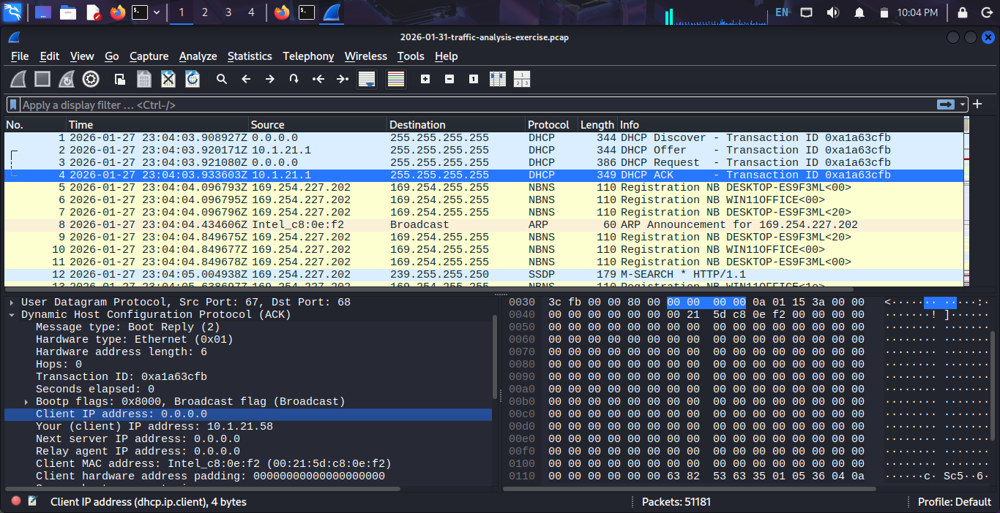
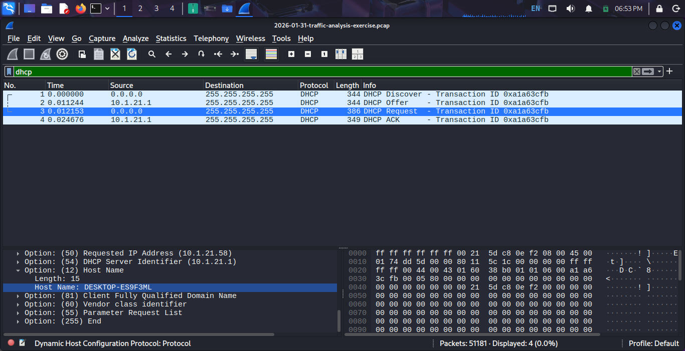
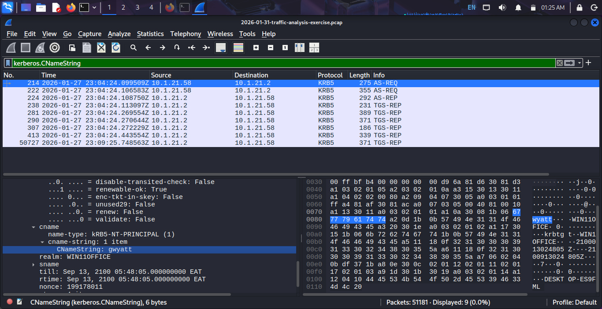
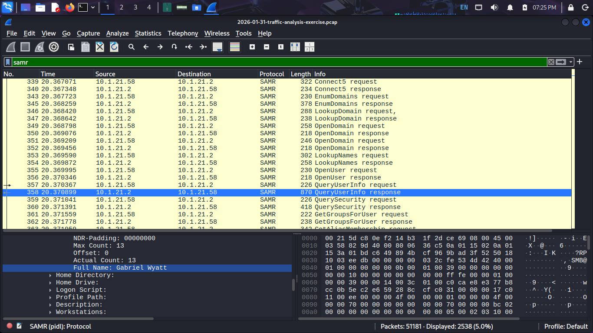
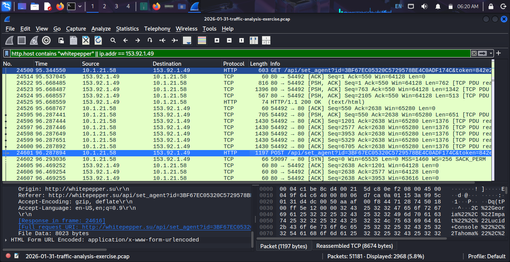
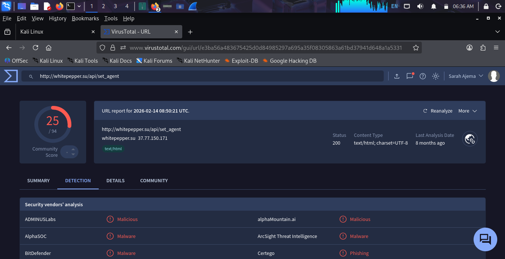

##### Incident Analysis Report: Lumma Stealer Network IOC Hunting

## 📋 Executive Summary
This repository details the packet analysis (`.pcap`) investigation of a network traffic capture. Using `Wireshark`, the investigation traced malicious activity from initial host communication and directory enumeration through `Kerberos` and `SAMR` protocols, ultimately identifying an active Command & Control (C2) beacon communicating with a malicious external domain (`whitepepper.su`). Threat intelligence validation via `VirusTotal` confirmed the external destination as malicious.

---

## 🔍 Investigation Overview

### Phase 1: Network Triage & Host Profiling
Initial inspection of the packet capture [2026-01-31-traffic analysis exercise.pcap](2026-01-31-traffic analysis exercise.pcap) revealed local DHCP transactions and NBNS broadcasts establishing the workstation's identity.
* **DHCP / IP Assignment:** Workstation assigned IP `10.1.21.58` via DHCP server `10.1.21.1`.
* **Hostname Identification:** DHCP options and NBNS traffic identified the target machine as `DESKTOP-ES9F3ML`.

> **Evidence:**
> 
> 

### Phase 2: Authentication & Account Discovery (Kerberos & SAMR)
Filtering internal protocol traffic uncovered active user session activity and enumeration queries.
* **Kerberos Activity:** Multiple AS-REQ and TGS-REQ exchanges were observed involving user account `gwyatt` under domain `WIN11OFFICE`.
* **SAMR Enumeration:** Security Account Manager Remote (SAMR) protocol queries (`QueryUserInfo`) executed against domain controller `10.1.21.2` revealed details of the target user profile.
  * **Target Account Name:** `Gabriel Wyatt`

> **Evidence:**
> * Kerberos Ticket Requests: 
> * SAMR User Enumeration: 

### Phase 3: Command & Control (C2) Traffic Analysis
Filtering HTTP traffic (`http.host contains "whitepepper"`) exposed external communication with suspicious infrastructure.
* **Source IP:** `10.1.21.58` (Compromised Workstation)
* **Destination IP / Domain:** `153.92.1.49` / [`whitepepper.su`](http://whitepepper.su)[cite: 12]
* **URI Pattern:** GET and POST requests to `/api/set_agent?id=3BF67EC05320C5729578...` indicating active beaconing/check-in behavior.

> **Evidence:**
> 

### Phase 4: Threat Intelligence Verification
The suspicious domain and URL path were evaluated against **VirusTotal** for threat vendor detections[cite: 13]
* **Target Endpoint:** [`http://whitepepper.su/api/set_agent`](http://whitepepper.su/api/set_agent)[cite: 13]
* **Vendor Consensus:** High-risk detection score across major engines (BitDefender, AlphaSOC, etc.)[cite: 13]
* **Threat Classification:** Malicious C2 / Phishing Infrastructure[cite: 13]

> **Evidence:**
> 

---

## 🎯 MITRE ATT&CK Mapping
To contextualize the adversary's lifecycle and behavior observed during the packet analysis, the findings have been mapped to the **MITRE ATT&CK Enterprise Matrix**:

| Tactic | Technique ID | Technique Name | Observed Evidence in Capture |
| :--- | :--- | :--- | :--- |
| **Discovery** | **T1087.002** | Domain Account | SAMR protocol queries (`QueryUserInfo`) executing against domain controller to profile user `gwyatt` (Gabriel Wyatt)[cite: 2, 4]. |
| **Credential Access** | **T1558** | Steal or Forge Kerberos Tickets | Multiple Kerberos ticket requests (`AS-REQ` and `TGS-REQ`) observed across domain infrastructure[cite: 2]. |
| **Command and Control** | **T1071.001** | Application Layer Protocol: Web Protocols | External HTTP GET/POST beaconing activity targeting `whitepepper.su` (`/api/set_agent`)[cite: 5, 6]. |

## ⏱️ Attack Timeline
* **23:04:03 UTC:** Host `DESKTOP-ES9F3ML` initializes network communication and receives IP address `10.1.21.58` via DHCP[cite: 1, 3, 5].
* **23:04:24 UTC:** Active user and directory enumeration observed via Kerberos authentication requests and SAMR protocol queries targeting user `gwyatt` (Gabriel Wyatt)[cite: 2, 4].
* **23:04:55+ UTC:** Suspicious HTTP POST/GET beaconing initiated toward external C2 infrastructure (`whitepepper.su` / `153.92.1.49`)[cite: 5, 6].

---

## 🛡️ Indicators of Compromise (IoCs)

| Indicator Type | Value | Context |

| **Domain** | `whitepepper.su` | Command & Control (C2) Host |
| **IP Address** | `153.92.1.49` | External C2 Infrastructure |
| **User Account** | `gwyatt` (Gabriel Wyatt) | Compromised Domain User |
| **Hostname** | `DESKTOP-ES9F3ML` | Internal Affected Host |
| **URI Endpoint** | `/api/set_agent` | Agent Check-in Route |

---

## 🛠️ Remediation & Mitigation Recommendations
1. **Host Isolation:** Immediately disconnect `DESKTOP-ES9F3ML` from the network to prevent further data exfiltration[cite: 1, 3, 5].
2. **Credential Revocation:** Terminate all active sessions and force a credential reset for user account `gwyatt`[cite: 2, 4].
3. **Perimeter Block:** Implement firewall and DNS-level blocks for IP address `153.92.1.49` and domain `whitepepper.su`[cite: 5, 6].
4. **Forensic Triage:** Perform disk and memory forensics on the endpoint to locate the payload dropper responsible for the C2 beacon.

*Report published as part of SOC threat hunting and network forensics practice.*
