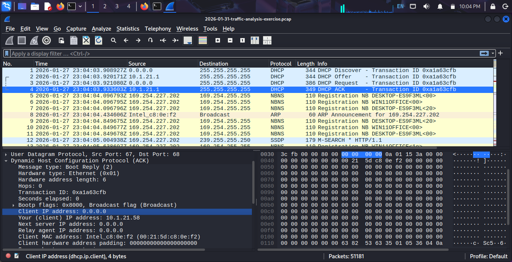
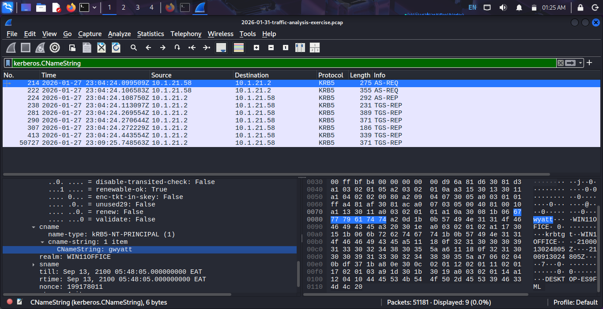
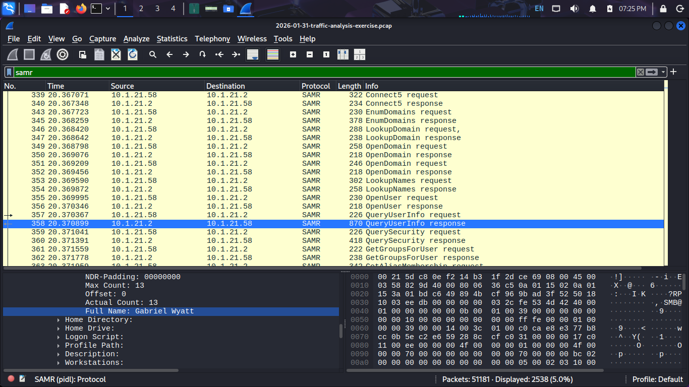
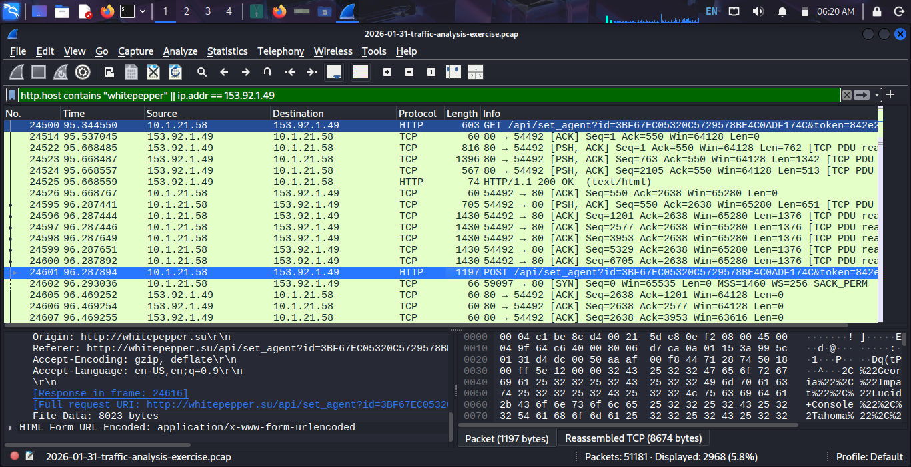
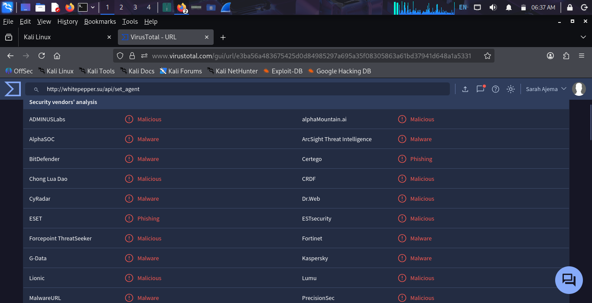

# Incident Analysis Report: Lumma Stealer Network IOC Hunting

## 📋 Executive Summary
This repository documents a network forensics investigation of a packet capture (`2026-01-31-traffic-analysis-exercise.pcap`) using Wireshark. The capture comes from a public training exercise on Malware-Traffic-Analysis.net based on a Lumma Stealer infection scenario. This report does not independently attribute the malware family from the PCAP alone.

The analysis identified an infected Windows workstation (`DESKTOP-ES9F3ML`, `10.1.21.58`, user `gwyatt`) communicating with attacker infrastructure at `whitepepper[.]su` (`153[.]92[.]1[.]49`).

### Key Findings
* The host loaded a clear-text HTTP page that fingerprinted the browser and system, then registered the victim under a unique ID (`3BF67EC0...`).
* It then sent repeated HTTP GET/POST beacons to `/api/set_agent` carrying the same ID, which is consistent with command-and-control (C2) check-in behaviour.
* VirusTotal flagged the domain and URL as malicious.
* Kerberos and SAMR traffic was used to profile the host and user. It is normal domain activity and is not treated as malicious on its own.
* **Limitation:** Most traffic after the initial beacon was TLS-encrypted, so the exact payload delivery method could not be confirmed from the PCAP alone.

---

## 🛑 Indicators of Compromise (IoCs)

| Type | Indicator | Context |
| :--- | :--- | :--- |
| **Domain** | `whitepepper[.]su` | C2 / victim registration server (Host and Origin headers) |
| **IP Address** | `153[.]92[.]1[.]49` | Contacted over HTTP (80) and TLS (443) |
| **URL Path** | `/api/set_agent` | Victim check-in route (GET and POST) |
| **Victim ID** | `3BF67EC05320C5729578BE4C0ADF174C` | Appears in the fingerprint page POST and in the beacons |
| **Hostname** | `DESKTOP-ES9F3ML` | Infected workstation (`10.1.21.58`) |
| **User Account** | `gwyatt` | Account logged in on the infected host |

---

## 🔍 Investigation Overview

### Phase 1: Network Triage and Host Profiling
DHCP transactions and NBNS broadcasts in the capture identify the workstation.

* **DHCP / IP assignment:** the workstation received `10.1.21.58` from the DHCP server `10.1.21.1`.
* **Hostname:** DHCP option 12 and NBNS registrations identify the machine as `DESKTOP-ES9F3ML`.

> **Evidence:**
> 

### Phase 2: Authentication and Account Context (Kerberos and SAMR)
Filtering internal protocol traffic identified the logged-in user. This is routine behaviour on a Windows domain and is documented as context, not as an indicator of compromise.

* **Kerberos:** `AS-REQ` and `TGS-REQ` exchanges for user `gwyatt` in domain `WIN11OFFICE` against the domain controller `10.1.21.2`. No ticket theft or forgery was observed.
* **SAMR:** `QueryUserInfo` requests to `10.1.21.2` returned the user profile. These calls are routine on Windows and cannot be attributed to the malware from this capture.
> **Evidence:**
> *Kerberos Exchange: 
> * SAMR User Profile Discovery: 
### Phase 3: Fingerprinting Page and Command-and-Control Traffic

#### 3a. Fingerprinting page (clear-text HTTP)
Following the HTTP stream (`tcp.stream eq 99`) shows a `200 OK` text/html page (page title "test") that runs JavaScript to collect:
* user agent, platform, language and hardware details
* screen size and installed-font checks
* WebGL/GPU information and a canvas fingerprint
* audio context and WebRTC data
* browser plugins and automation flags

The script then POSTs this data to `?id=3BF67EC0...&token=...` and redirects the browser to `about:blank`. The `Date` header of the response is `Tue, 27 Jan 2026 23:05:39 GMT`.

#### 3b. C2 beacons
Filtering with `http.host contains "whitepepper"` || `ip.addr == 153.92.1.49` shows:
* **Source:** `10.1.21.58` (infected workstation)
* **Destination:** `153[.]92[.]1[.]49` / `whitepepper[.]su` (the Host and Origin headers show the domain)
* **URI pattern:** repeated GET and POST requests to `/api/set_agent?id=3BF67EC0...` carrying the same victim ID as the fingerprint page

This match between the fingerprint page and the beacons ties both events to the same operation.

> **Evidence:**
> 

### Phase 4: Threat Intelligence Verification
The domain and URL were checked on VirusTotal.

* **Target endpoint:** `hxxp://whitepepper[.]su/api/set_agent`
* **Result:** flagged as malicious by multiple security vendors (25 of 94 in the screenshot taken for this report)
* **Note:** VirusTotal later showed a different IP for the domain than the one in the capture. Domains can change IPs over time, so the domain-to-IP link in this report rests on the Host and Origin headers in the PCAP.

> **Evidence:**
> 

---

## 🎯 MITRE ATT&CK Mapping
Techniques are split into confirmed (direct evidence of malicious activity) and contextual (normal behaviour that helped profile the host and user).

### Confirmed
| Tactic ID & Name | Technique | Evidence in capture |
| :--- | :--- | :--- |
| **T1071.001** Application Layer Protocol: Web Protocols | Command and Control | Clear-text HTTP GET/POST beacons from `10.1.21.58` to `whitepepper[.]su` on `/api/set_agent`, repeated over time |
| **T1082** System Information Discovery | Discovery | The page in stream 99 collected browser, hardware, screen, font, WebGL, canvas, audio and WebRTC data |
| **T1041** Exfiltration Over C2 Channel | Exfiltration | The collected data was POSTed to the same server that handled the beacons |

### Contextual (not confirmed malicious)
| Observed activity | Why it is listed |
| :--- | :--- |
| **DHCP and NBNS traffic** | Identified the host (`DESKTOP-ES9F3ML`, `10.1.21.58`) |
| **Kerberos AS-REQ/TGS-REQ** | Normal domain logon. It identified the user and domain `gwyatt` |
| **SAMR QueryUserInfo to 10.1.21.2** | Routine on Windows domains. Possibly related to `T1087.002`, but not attributable to the malware from this capture |

---

## ⏱️ Attack Timeline
*All times are UTC on 27 January 2026.*

* **23:04:03** — Host `DESKTOP-ES9F3ML` starts up and receives `10.1.21.58` via DHCP.
* **23:04:24** — Kerberos authentication for `gwyatt` and SAMR queries to the domain controller.
* **23:05:39** — Host loads the clear-text fingerprinting page and registers the victim (context).
* **Shortly after** — Repeated GET/POST beacons to `/api/set_agent` on `whitepepper[.]su` / `153[.]92[.]1[.]49` later further traffic to the same IP over TLS (port 443), which cannot be inspected without keys.

---

## ⚠️ Limitations
Most traffic after the initial beacon was TLS-encrypted, so the exact payload delivery method (for example a download or a user-run command) could not be confirmed from the PCAP alone. Confirming it would need endpoint logs, proxy logs or a TLS key log. Malware family attribution comes from the exercise description, not from payload analysis in this report.

---

## 🛡️ Remediation and Mitigation Recommendations
* **Host isolation:** disconnect `DESKTOP-ES9F3ML` from the network to prevent further data loss.
* **Credential reset:** terminate active sessions and force a password reset for `gwyatt`.
* **Perimeter block:** add firewall and DNS blocks for `153[.]92[.]1[.]49` and `whitepepper[.]su`.
* **DNS logs:** search proxy and DNS logs for other hosts contacting the domain or using the same victim ID pattern.
* **Forensic triage:** run disk and memory forensics on the endpoint to locate the payload responsible for the beacon.

---

## 🧰 Tools and Skills
* **Tools:** Wireshark, Kali Linux, VirusTotal, MITRE ATT&CK
* **Skills:** Network traffic analysis, protocol analysis, IOC extraction, threat hunting, incident reporting.

---

*Report published as part of SOC threat hunting and network forensics practice.*  
*Training capture credit: Malware-Traffic-Analysis.net*
